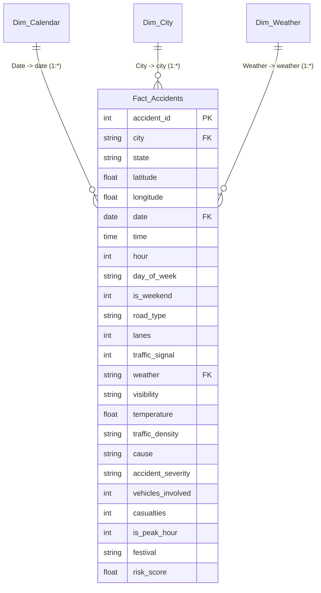

# UrbanFlow - Power BI Dashboard Architecture & Implementation Guide

This guide details the complete blueprint for reproducing, customizing, and scaling the **UrbanFlow Smart City Traffic & Accident Analysis Dashboard** in Microsoft Power BI Desktop.

---

## 1. Data Model & Architecture (Star Schema)

The dashboard uses an optimized Star Schema model designed for high-performance cross-filtering:

### Table Relationships
1. **Fact_Accidents** (`accident_data`) connected to **Dim_Calendar** on `'accident_data'[date] = 'Dim_Calendar'[Date]` (Many-to-One `*:1`, Single Direction).
2. **Fact_Accidents** (`accident_data`) connected to **Dim_City** on `'accident_data'[city] = 'Dim_City'[City]` (Many-to-One `*:1`, Both/Single Direction).

---

## 2. Report Pages & Visual Wireframes

The report is structured into 4 interactive pages tailored for urban traffic commissioners, city planners, and enforcement authorities:

### Page 1: Executive KPI & Safety Overview
- **Header Banner**: City slicer (Dropdown: Delhi, Mumbai, Bengaluru, Pune, Kolkata, Chandigarh, Chennai, Hyderabad), Date Range Slicer (Between 2022 to 2025), Severity filter.
- **Top KPI Cards**:
  - `Total Accidents`: 20,000
  - `Total Casualties`: 39,800+
  - `Fatal Accident Rate`: ~14.9%
  - `Average Risk Score`: ~0.44
  - `Peak Hour Incident %`: ~29.1%
- **Visual 1 (Donut Chart)**: Accident Severity breakdown (`Minor` 55.1%, `Major` 29.9%, `Fatal` 14.9%).
- **Visual 2 (Line & Clustered Column)**: Monthly Incident Trend (X: Month-Year, Y: Total Accidents, Line: Average Risk Score).
- **Visual 3 (Bar Chart)**: Accidents by City sorted descending, with color saturation mapped to Fatal Rate.

### Page 2: Geospatial & Hotspot Intelligence
- **Visual 1 (Map / ArcGIS Visual)**:
  - Latitude: `'accident_data'[latitude]`
  - Longitude: `'accident_data'[longitude]`
  - Size: `[Total Casualties]`
  - Color: `[Average Risk Score]` (Diverging Green -> Yellow -> Crimson Red)
  - Tooltips: City, Road Type, Cause, Weather, Vehicles Involved
- **Visual 2 (Decomposition Tree)**:
  - Metric: `[Total Accidents]`
  - Explain By: `Road Type` -> `Lanes` -> `Traffic Signal` -> `Accident Severity`
- **Visual 3 (Matrix Grid)**: High-risk corridors sorted by `[High Risk Incidents]` with data bars for casualties.

### Page 3: Temporal & Environmental Root Cause Analysis
- **Visual 1 (Heatmap Matrix)**:
  - Rows: `Day of Week` (Monday through Sunday)
  - Columns: `Hour of Day` (0 to 23)
  - Values: `[Total Accidents]` (Color scale: White to Deep Red)
- **Visual 2 (Stacked Bar Chart)**: Primary Accident Causes (`Distraction`, `Overspeeding`, `Drunk Driving`, `Poor Road`, `Weather`) by Severity.
- **Visual 3 (Clustered Column Chart)**: Weather (`Clear`, `Fog`, `Rain`) vs. Visibility (`Low`, `Medium`, `High`) showing Average Risk Score.

### Page 4: Predictive Risk & Enforcement Action Matrix
- **Visual 1 (Gauge Chart)**: Dynamic Risk Tier Indicator (`Low Risk <0.30`, `Medium Risk 0.30-0.70`, `Critical >0.70`).
- **Visual 2 (Scatter Plot)**:
  - X-Axis: `Vehicles Involved`
  - Y-Axis: `Casualties`
  - Play Axis / Legend: `Accident Severity`
  - Size: `Risk Score`
- **Visual 3 (Action Table)**: Actionable interventions grouped by city and road type with priority scoring based on `[Severity Index Score]`.

---

## 3. How to Open & Configure `UrbanFlow.pbix`

1. Launch **Microsoft Power BI Desktop**.
2. Click **File > Open** and select `PowerBI/UrbanFlow.pbix`.
3. In Power Query editor, verify the source path points to `Dataset/accident_data.csv`.
4. Click **Apply & Close** to refresh data.
5. All DAX measures in `PowerBI/DAX_Measures.dax` are already organized into the `_Key_Measures` table folder for instantaneous reporting.
