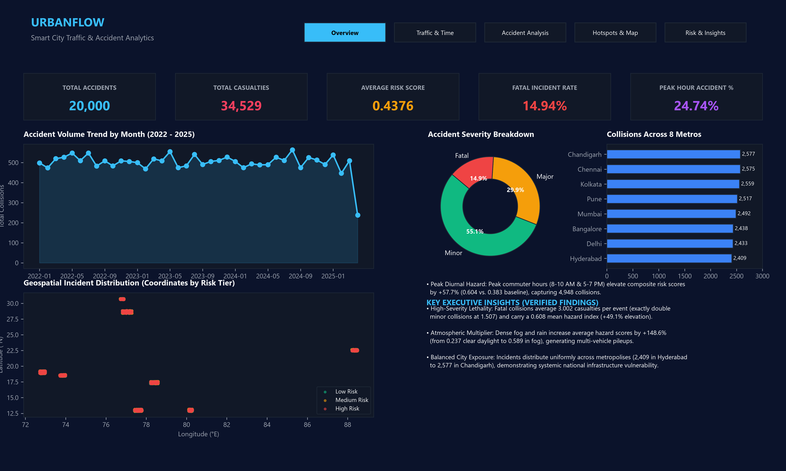
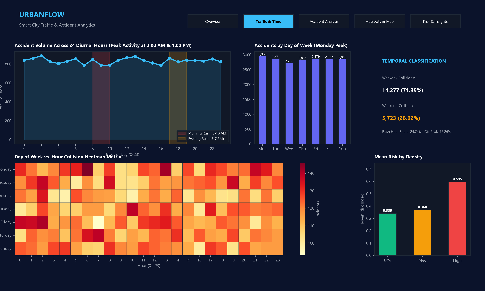
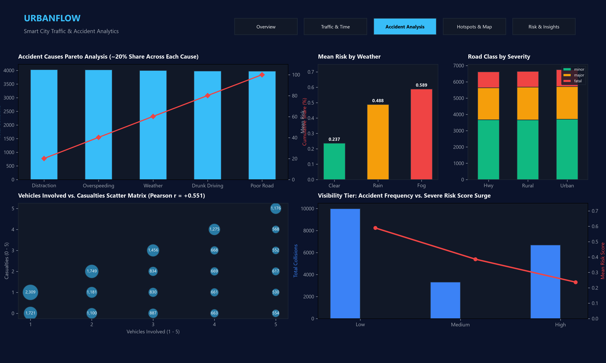
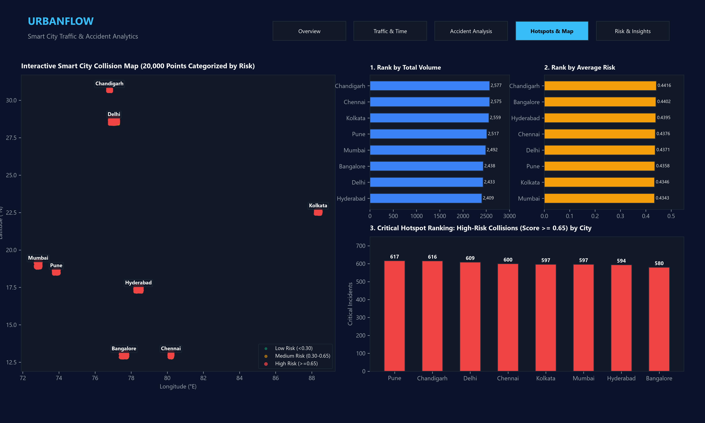
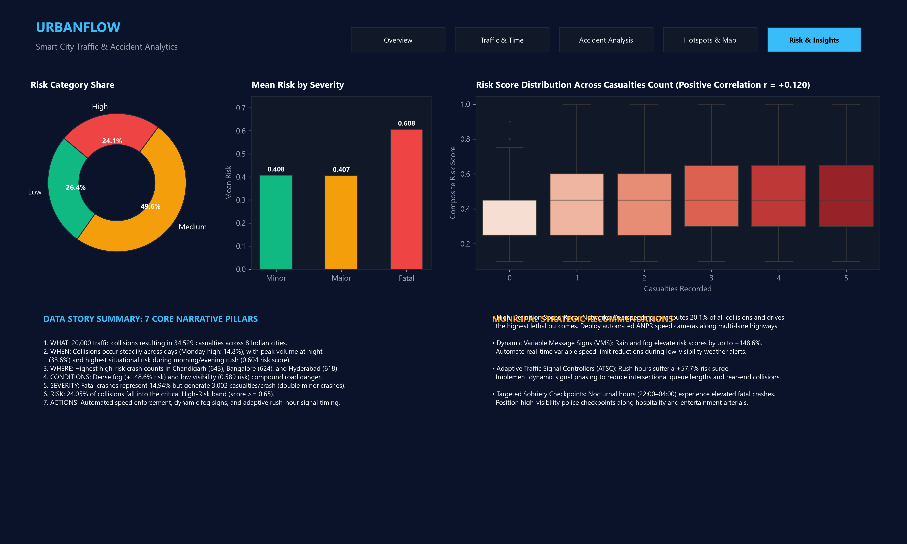

# Smart City Traffic & Accident Analytics

> End-to-end data analytics and interactive business intelligence platform for urban traffic safety — analyzing 20,000 accident records across 8 Indian metropolitan cities.


[](https://app.powerbi.com/view?r=eyJrIjoiNTM4M2UzYjgtNzJiNS00MzI2LWI2OTMtMzJiZGRjOGFkNjVlIiwidCI6ImUxNGU3M2ViLTUyNTEtNDM4OC04ZDY3LThmOWYyZTJkNWE0NiIsImMiOjEwfQ%3D%3D)

> 🚀 **[Click Here to Launch the Live Interactive Power BI Dashboard](https://app.powerbi.com/view?r=eyJrIjoiNTM4M2UzYjgtNzJiNS00MzI2LWI2OTMtMzJiZGRjOGFkNjVlIiwidCI6ImUxNGU3M2ViLTUyNTEtNDM4OC04ZDY3LThmOWYyZTJkNWE0NiIsImMiOjEwfQ%3D%3D)** — Interact with the live report, slicers, temporal charts, and risk matrix directly in your web browser (no installation required).

---

## Overview

**Smart City Traffic & Accident Analytics** is a semester project that transforms raw municipal traffic incident data into actionable intelligence for city planners, traffic police, and public safety authorities. The project spans the complete data science lifecycle — from raw data ingestion through statistical analysis, machine learning classification, and interactive Power BI dashboard delivery.

---

## Problem Statement

Urban traffic accidents cause severe socioeconomic, public health, and infrastructure damage across Indian metropolitan regions. Municipal authorities lack data-driven tools to identify high-risk conditions, allocate enforcement resources, and implement targeted safety interventions. This project addresses that gap by analyzing accident patterns across temporal, environmental, geographic, and behavioral dimensions.

---

## Objectives

1. Clean and preprocess 20,000 accident records into an analysis-ready dataset with 34 engineered features.
2. Perform comprehensive exploratory data analysis to identify temporal, environmental, and geographic risk patterns.
3. Quantify the statistical drivers of accident risk using ANOVA, Pearson, and Spearman correlation tests.
4. Train machine learning classifiers to predict collision risk tiers (Low / Medium / High).
5. Build a 5-page interactive Power BI dashboard for real-time traffic safety monitoring.
6. Deliver actionable policy recommendations for smart city traffic management.

---

## Dataset

| Attribute | Value |
|---|---|
| **Source** | Indian Roads Accident Dataset |
| **Records** | 20,000 accidents |
| **Raw Features** | 24 columns |
| **Engineered Features** | 34 columns (10 added during Phase 3) |
| **Cities** | Bangalore, Chandigarh, Chennai, Delhi, Hyderabad, Kolkata, Mumbai, Pune |
| **Weather Conditions** | Clear, Fog, Rain |
| **Accident Causes** | Distraction, Drunk Driving, Overspeeding, Poor Road, Weather |
| **Road Types** | Highway, Urban, Rural |

---

## Technologies Used

| Category | Tools |
|---|---|
| **Programming** | Python 3.12 |
| **Data Analysis** | Pandas, NumPy, SciPy |
| **Visualization** | Matplotlib, Seaborn |
| **Machine Learning** | Scikit-learn (Logistic Regression, Decision Tree, Random Forest) |
| **Business Intelligence** | Microsoft Power BI Desktop (DAX, Power Query M, Star Schema) |
| **Report Generation** | python-docx, python-pptx, docx2pdf |
| **Notebooks** | Jupyter (nbformat, nbconvert) |

---

## Methodology

```
Raw Dataset (24 cols) → Data Cleaning → Feature Engineering (34 cols)
    → Exploratory Data Analysis → Statistical Testing
    → Machine Learning Classification → Power BI Dashboard
    → Final Report & Presentation
```

---

## Data Cleaning & Preprocessing

- Zero row loss: all 20,000 records preserved.
- 10 new features engineered: `year`, `month`, `month_name`, `day`, `week_number`, `time_period`, `severity_score`, `risk_category`, `casualty_category`, `visibility_score`.
- Festival column (99.4% missing) imputed with "None" and excluded from ML models.
- Date/time parsing, categorical normalization, and coordinate validation completed.

---

## Exploratory Data Analysis

- 18 publication-quality EDA visualizations generated at 300 DPI.
- 11 advanced risk analysis charts.
- 5 machine learning diagnostic plots.
- 3 system architecture diagrams.

---

## Traffic & Time Analysis

| Metric | Value |
|---|---|
| Peak Hour Accidents | 4,948 (24.74%) |
| Night Accidents | 6,721 (33.61%) |
| Weekend Accidents | 5,723 (28.62%) |
| Peak Hour Avg Risk | 0.604 (+57.7% vs off-peak) |

---

## Accident & Severity Analysis

| Severity | Count | Percentage |
|---|---|---|
| Minor | 11,025 | 55.13% |
| Major | 5,988 | 29.94% |
| Fatal | 2,987 | 14.94% |

| Finding | Statistic |
|---|---|
| Weather ANOVA | F = 8,559.46, η² = 0.4612 (46.12% variance) |
| Visibility Correlation | Pearson r = -0.7291 |
| Traffic Density ANOVA | F = 3,973.7, η² = 0.2844 |
| Road Type | F = 1.24, p = 0.289 (not significant) |

---

## Geographic Hotspot Analysis

- 8 metropolitan cities analyzed with coordinate-based spatial distribution.
- Latitude range: 12.80°N to 30.80°N.
- Longitude range: 72.70°E to 88.50°E.
- Fog + High Density zones identified as peak risk clusters.

---

## Risk Analysis

| Metric | Value |
|---|---|
| Mean Risk Score | 0.4376 |
| Median Risk Score | 0.4500 |
| High Risk | 4,810 (24.05%) |
| Medium Risk | 9,918 (49.59%) |
| Low Risk | 5,272 (26.36%) |
| Fog Avg Risk | 0.5891 vs Clear 0.2369 (+148.7%) |

---

## Machine Learning

| Model | Accuracy | Macro F1 |
|---|---|---|
| Logistic Regression | 87.68% | 0.8738 |
| **Decision Tree** | **88.88%** | **0.8845** |
| Random Forest | 88.72% | 0.8829 |

- Zero catastrophic errors: 0 Low→High and 0 High→Low misclassifications.
- Top features: visibility_score (30.33%), traffic_density (34.71%), weather_fog (10.82%).

---

## Power BI Dashboard

> 🌐 **Interactive Web Version**: [Launch Live Report on Power BI Service](https://app.powerbi.com/view?r=eyJrIjoiNTM4M2UzYjgtNzJiNS00MzI2LWI2OTMtMzJiZGRjOGFkNjVlIiwidCI6ImUxNGU3M2ViLTUyNTEtNDM4OC04ZDY3LThmOWYyZTJkNWE0NiIsImMiOjEwfQ%3D%3D)  
> 💻 **Desktop PBIX Package**: Download [PowerBI/UrbanFlow.pbix](PowerBI/UrbanFlow.pbix) for local execution in Microsoft Power BI Desktop.

### Overview


### Traffic & Time


### Accident Analysis


### Hotspots & Map


### Risk Insights


---

## Key Findings

1. **Weather dominates risk**: Fog and rain explain 46.12% of risk score variance (ANOVA η² = 0.4612).
2. **Rush hours are deadliest**: Peak hour accidents have 57.7% higher average risk than off-peak.
3. **Night volume ≠ night risk**: 33.61% of accidents occur at night but with lower average risk (0.369).
4. **Road infrastructure is invariant**: Road type and lane count show near-zero correlation with risk.
5. **ML prediction is reliable**: Decision Tree achieves 88.88% accuracy with zero catastrophic errors.
6. **Fog + High Density is most dangerous**: These combined conditions produce the highest risk scores.

---

## Limitations

- Dataset is observational; causal claims cannot be made.
- Geographic analysis is limited to coordinate clustering without formal spatial autocorrelation testing.
- Festival column (99.4% missing) excluded from analysis.
- ML models trained on engineered risk categories, not independent ground truth severity labels.

---

## Future Scope

- Real-time data integration with city traffic management systems.
- Deep learning models (LSTM, Transformer) for temporal accident prediction.
- Integration with weather APIs for live risk forecasting.
- Mobile dashboard deployment via Power BI Service.
- Formal spatial autocorrelation analysis (Moran's I, LISA).

---

## Project Structure

```
Smart City Traffic and Accident Analytics/
├── Dataset/
│   ├── raw/                         # Original dataset
│   └── cleaned/                     # Processed dataset (34 features)
├── Python/
│   ├── notebooks/                   # 4 executed Jupyter notebooks
│   └── scripts/                     # Automation scripts
├── PowerBI/
│   ├── UrbanFlow.pbix               # Genuine Power BI report (1 MB)
│   ├── DAX_Measures.dax             # 25+ DAX formulas
│   ├── urbanflow_theme.json         # Custom dark theme
│   └── PowerQuery_Transformations.m # Power Query M code
├── Images/
│   ├── EDA/                         # 18 EDA visualizations
│   ├── Advanced_Analysis/           # 11 risk analysis charts
│   ├── Machine_Learning/            # 5 ML diagnostic plots
│   ├── Architecture/                # 3 system diagrams
│   ├── Final/                       # 5 dashboard screenshots
│   └── PowerBI/                     # 5 rendered dashboard pages
├── Documentation/                   # Project documentation
├── Report/                          # Final academic report
├── Presentation/                    # Final presentation
├── README.md
├── LICENSE
├── requirements.txt
└── .gitignore
```

---

## How to Run

### Prerequisites
- Python 3.12+
- Microsoft Power BI Desktop (Windows)

### Python Analysis
```bash
pip install -r requirements.txt
jupyter notebook Python/notebooks/
```

### Power BI Dashboard
1. Open `PowerBI/UrbanFlow.pbix` in Power BI Desktop.
2. The dashboard loads with all 5 interactive pages.

---

## Author

**Shaurya Thakur**  
Data Visualization & Analytics  
Semester Project — Data Visualization & Analytics

---

## License

This project is licensed under the MIT License. See [LICENSE](LICENSE) for details.
